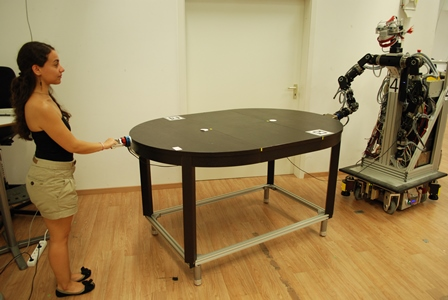

# Koc-TUM Physical Human-X Interaction Repository

This repository contains real (i.e. not simulated) haptic interaction data collected from both Human-Human and Human-Robot dyads in joint object manipulation scenarios. Both scenarios were realized at the Chair for Information-oriented Control (S. Hirche), Technische Universität München and supported in part within the DFG excellence initiative research cluster "Cognition for Technical Systems – CoTeSys" ([www.cotesys.org](https://www.cotesys.org)). The scenarios involve two agents carrying a large table on ball casters in a laboratory setting. Force and position information is recorded during interaction.

The dataset is collected as a result of joint research between Technische Universität München (Chair for Information-oriented Control) and Koc University (Robotics and Mechatronics Laboratory and Intelligent User Interfaces Laboratory). The copyright of the data remains with these institutions.

*Human Robot Interaction Setup*

Please note that this dataset is available for **research purposes only**. If you are interested in using the dataset, please do so by citing the following paper:

Alexander Moertl, Martin Lawitzky, Ayse Kucukyilmaz, T. Metin Sezgin, Cagatay Basdogan, and Sandra Hirche. **The Role of Roles: Physical Cooperation between Humans and Robots.** *The International Journal of Robotics Research*, vol. 31, no. 13, pp. 1656-1674 (2012). [[Bibtex](pubs/moertl2012roles.bib)] [[DOI](https://doi.org/10.1177/0278364912455366)].

The experimental procedure, and the details of how data is collected can be found in the aforementioned paper.

### Koc-TUM pHRI (physical Human-Robot Interaction) Dataset

This set consists of data collected from 18 human-robot dyads. For each dyad, the data is recorded at 1 kHz, smoothed with low-pass filtering at 15 Hertz cutoff frequency, and stored as a Matlab struct.

### Koc-TUM pHHI (physical Human-Human Interaction) Dataset

This set consists of data collected from human-human dyads performing the same table-carrying task, stored as Matlab structs.

### Downloads

- **Human-Robot (HR) Data**
  - [Readme.txt](data/HR/Readme.txt) (1.7 KB)
  - [Koc_TUM_pHRI_data](https://www.dropbox.com/scl/fi/23hiixmwvjx2wgjg2w85h/KocTUM_HR_data.zip?rlkey=yxdlgxve129phsec7gdid0dwj&dl=0) (916MB)
- **Human-Human (HH) Data**
  - [Readme.txt](data/HH/README.txt) (1.57 KB)
  - [Koc_TUM_pHHI_data](data/HH/KocTUM_HH_data.zip) (1.4MB)

### Related

- [Haptic Human-Human Interaction – Behaviour Recognition Dataset](https://github.com/aysekyz/HHIBehaviorDataset)
- [Koc University RML repository](https://research.ku.edu.tr/research-infrastructure/laboratories/rml/)

### Contact

May you have any queries, please direct them to Ayse Kucukyilmaz via e-mail: ayse.kucukyilmaz@nottingham.ac.uk

### License

This dataset is licensed under a [Creative Commons Attribution-NonCommercial-NoDerivatives 4.0 International License](https://creativecommons.org/licenses/by-nc-nd/4.0/). See [LICENSE](LICENSE).
